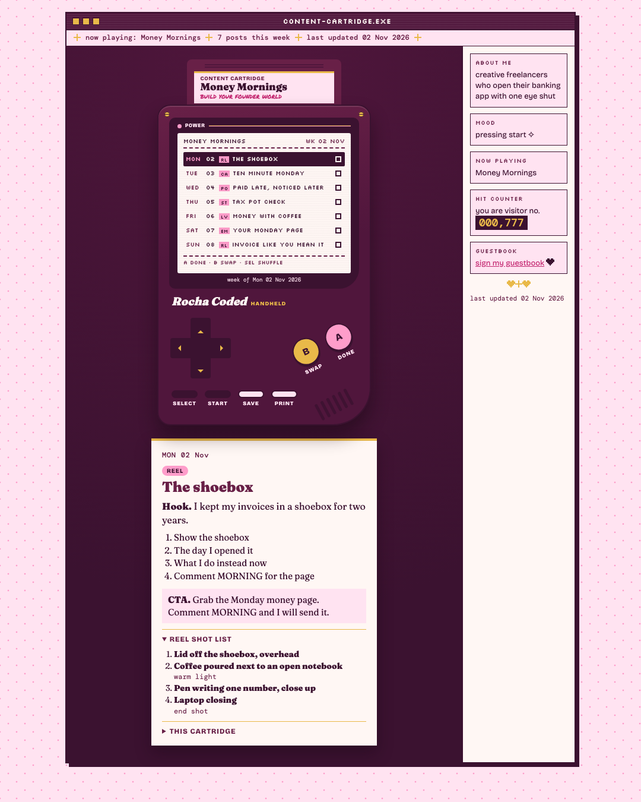
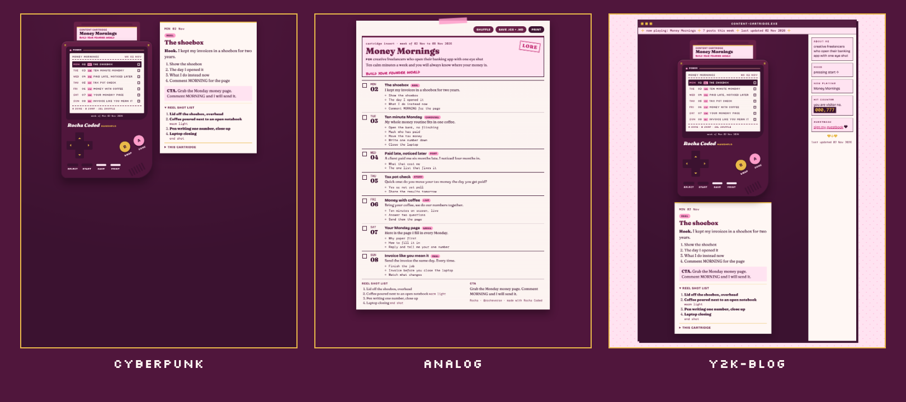

# Content Cartridge

*Rocha Coded. Free tools from the Rocheverse.*

**A Game Boy in the browser. Insert a cartridge, press START, get the week.**

A cartridge is one content pillar, in your words.
Who it is for, what you promise her, what you want her to do next.
Five to seven post ideas, each with a hook, the beats and the format.
A shot list for the reel.
Press START and the week lays itself out, Monday to Sunday.
Mark posts done, swap days, shuffle, then save the week to your calendar or print it.

<p align="center"></p>

<p align="center"></p>

<p align="center"><sub>One cartridge, three moods: cyberpunk, analog, y2k-blog. A made-up pillar for a made-up bookkeeper. Every word on it is fictional.</sub></p>

## Start here
You can do this. Each step tells you what to type and what you will see when it worked.

**If you use Claude Code** (Claude in the terminal, the window where you type commands to your computer):

 Open the Terminal app. On a Mac it is in Applications > Utilities > Terminal.
   This checks that Python, the language the tool is written in, is ready:
   ```sh
   python3 --version
   ```
   You will see `Python 3.10` or a higher number.

 This copies the tool onto your computer. "Clone" means download a copy from GitHub, the site where the code lives:
   ```sh
   git clone https://github.com/RochaStone/content-cartridge ~/.claude/skills/content-cartridge
   ```
   You will see `Cloning into...` and then the line where you type comes back.

 This makes a folder for your cartridges and opens Claude Code inside it:
   ```sh
   mkdir -p ~/content-week && cd ~/content-week && claude
   ```
   You will see Claude Code open and wait for you.

 Type this to Claude, in your own words if you like:
   ```
   Make me a content cartridge.
   ```
   You will see Claude ask your first question, about your pillar. It asks one thing at a time.

 When Claude says your cartridge is in, this opens it in your browser (swap in your cartridge name):
   ```sh
   open out/money-mornings.html
   ```
   You will see the handheld with PRESS START on the screen. Press Enter, or click START.

**If you use Claude Cowork** (the Claude desktop app): download the zip (one file that holds the whole tool),
upload it in Customize > Skills, give a task your content folder, and say "Make me a content cartridge."
The full steps are under [Claude Cowork](#claude-cowork).

<p align="center"></p>

## What you get
- **The handheld.** Your week on a cream screen in a plum shell. The card beside it shows the hook and beats for the day you are on.
- **The buttons.** START lays out the week. The arrows move between days. A marks a post done. B picks a day up, then B again swaps it. SELECT shuffles the posts. Rest days stay where they are.
- **SAVE.** Downloads `week.ics` and `week.md`. Open `week.ics` and your calendar app adds one all-day event per post, with the hook and beats inside. `week.md` is the same week as plain notes.
- **PRINT.** One page: the cartridge label and the week sheet, with a tick box for every day.
- **Your words.** Claude interviews you and writes the cartridge from your answers and your stories. The file is yours to edit any time.

Five posts give you two rest days, Wednesday and Sunday. Six give you Sunday off. Seven fill the week.

<p align="center"></p>

## Install
It runs inside Claude. Nothing to host, no account to make, and your cartridges stay on your computer.

| Where you use it | Install it | Start it |
|---|---|---|
| [Claude Code](#claude-code) (recommended) | clone into `~/.claude/skills` | ask "make me a content cartridge" |
| [Claude Cowork](#claude-cowork) | upload `content-cartridge.zip` as a skill | ask for a content cartridge in a Cowork task |

You need Python 3.10 or newer. For a picture of the page you also need Google Chrome or Chromium.
Without it you still get the page, the calendar file and the notes.

### Claude Code
```sh
git clone https://github.com/RochaStone/content-cartridge ~/.claude/skills/content-cartridge
```
Open Claude Code in a folder where you want your cartridges saved, and ask: "Make me a content cartridge."
To update later: `git -C ~/.claude/skills/content-cartridge pull`.

### Claude Cowork
Cowork (the Claude desktop app) runs tasks in a sandbox on your computer that can only reach the folders you give it.
1. Download `content-cartridge.zip` from the [latest release](https://github.com/RochaStone/content-cartridge/releases/latest).
2. In the Claude desktop app: Customize > Skills, then + > Create skill > Upload a skill, and pick the zip.
3. In Settings > Capabilities, turn on code execution and file creation.
4. Make a folder, for example `content-week` in your home folder. Start a Cowork task, give it access to that
   folder, and ask: "Make me a content cartridge."

When it is done, open the `.html` file from your folder in your browser to play.

<p align="center"></p>

## How to use it
Claude asks you four things, one at a time: your pillar, who it is for, what you want her to do, and three stories.
It drafts five to seven posts from your stories and shows you the list first. Swap any you like.
Then it writes `cartridges/<your-pillar>.json` and inserts it.

Keys, if you prefer the keyboard: arrows move, Enter is START, A or X is A, B or Z is B, Shift is SELECT,
S saves and P prints. Your done marks are remembered in your browser for that week.

Three fictional cartridges ship in `cartridges/` so you can play before you make your own:
`behind-the-kiln` (a pottery studio), `money-mornings` (a bookkeeper for freelancers) and `studio-rituals`
(a movement studio). Every word in them is made up.

## If it goes wrong (everyone's first time) 
This happens to everyone the first time. Here are the three most common moments and the fix for each.
- **The terminal says `command not found` for `python3` or `git`.** Your Mac may offer to install its developer tools. Click Install, wait for it to finish, and run the step again. If nothing pops up, install Python from python.org.
- **The check says the cartridge "needs a little care".** Each line says what to change, for example "posts should hold 5 to 7 post ideas". Tell Claude "fix it" and it will, or edit the file and check again.
- **SAVE downloads only one file.** Your browser may ask "allow multiple downloads?". Click Allow, then press SAVE again.

<p align="center"></p>

## Make it yours
Your look lives in one file, `style.json`: your colours, fonts, your own scrawl line for the cartridge label and your own stamp for the printed sheet.
It ships with two examples: `examples/style.rocha-coded.json` (my plum and candy pink) and a blank `style.example.json` for yours, explained in `STYLE.md`. Or ask Claude to make one with you from a few references.
Pick your motif, `cyberpunk`, `analog` or `y2k-blog`, to change the structure. Your palette and fonts re-tone all three, so every version is yours to curate.
The same file works across every Rocha Coded tool, so you make it once.

## What's inside
| File | What it does |
|---|---|
| `SKILL.md` | the steps Claude follows: the interview, the draft, the check, the build |
| `cartridge.py` | checks a cartridge, lays out the week, writes `week.ics` and `week.md`, and builds the page |
| `render.py` | draws the page in all three motifs from one function, reads `style.json`, makes pictures |
| `assets/` | the handheld and print sheet (`handheld.css`), the booklet (`motif-analog.css`), the blog window (`motif-y2k.css`) and the buttons (`handheld.js`) |
| `cartridges/` | three fictional sample cartridges |
| `examples/` | Rocha's example style, and the sample page, `week.ics` and `week.md` |
| `scripts/make-readme-images.py` | makes every image in this README from the tool itself, listed in `docs/IMAGES.md` |
| `tests/` | the tests, and `tests/TESTING.md` with exactly what was run |
| `style.example.json`, `STYLE.md` | your look in one file, and what each key does |

Everything is plain Python from the standard library. No packages to install.
The page loads its fonts from Google Fonts and falls back to fonts already on your computer when you're offline.

For the curious, run it by hand:
```sh
python3 cartridge.py build cartridges/money-mornings.json --out out/ --motif y2k-blog
```

## Licence
MIT. See [LICENSE](LICENSE). Copyright (c) 2026 Rochelle Livingstone / Thriving Era Studio.

 [Sign my guestbook](https://github.com/RochaStone/content-cartridge/issues)

## Made by Rocha

Rocha \
Brand Alchemist & AI Architect \
Author of *Brand Alchemy in the Thriving Era* \
Creator of [Conscious Founder OS](https://founders.thrivingera.com) \
Founder, [Thriving Era Studio](https://thrivingera.com)

I take female founders AI native in 7 days, and I build what they need next. \
Start with the audit: [thrivingera.com/audit](https://thrivingera.com/audit). \
Or book an exploratory call: [calendly.com/rochelle-thrivingera/exploratory-call](https://calendly.com/rochelle-thrivingera/exploratory-call). It is where we decide if we work together.

[Instagram @rocheverse](https://instagram.com/rocheverse) · [Substack](https://rochastone.substack.com) · [LinkedIn](https://www.linkedin.com/in/rochellelivingstonecosmic) · [More free tools](https://thrivingera.com/free) · [All tools on GitHub](https://github.com/RochaStone)
